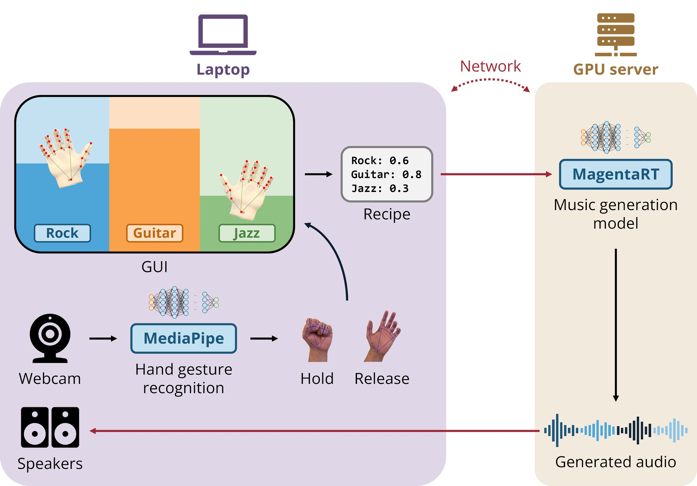

# SuperConductor client

This checkout is the client. Tracking, conducting, describe, and the MIDI player live in `superconductor_client/`. The music server is the `server` branch, in `../superconductor_server`. Atlas, playback, and TouchDesigner are their own checkouts. `make worktrees` creates the ones that are missing.

`make client` starts the client together with tracking, conducting, describe, and midi. The browser is the camera, the view, and the speakers. Each process also has its own command: `sc-client`, `sc-tracking`, `sc-conduct`, `sc-describe`, `sc-midi`.

Testing, on the laptop or on lh2300, is `git pull`, `make setup`, `make client`. `make setup` is idempotent. On macOS it creates `sc_env` if that conda env is missing. On lh2300 it creates `.venv` from `client_container/requirements.txt` (CUDA 12.6, for the V100) and the client runs from that checkout, without Singularity. The music weights are `make setup` in the server checkout. On macOS that downloads `mrt2_small` and skips `mrt2_base`.

The Singularity image is the release build. `make sif` pulls it, and `make client-singularity` runs it. Details are in [client_container/README.md](client_container/README.md).

There are three ways to run it.

## 1. Everything on the laptop

The music server is `mrt2_small` on the laptop, port 9100.

**Once:**

```bash
git clone -b client https://github.com/dennisfarmer/superconductor.git superconductor_client
cd superconductor_client
make worktrees
make setup
cd ../superconductor_server && make setup && cd -
```

`make setup` here builds `sc_env`. `make setup` in the server checkout downloads `mrt2_small`.

**Each time,** from this checkout: `git pull && make setup`. In the server checkout, the same, then:

1. `make server`. Wait for `Serving mrt2_small (mlx) on port 9100`. The client connects once at startup, so the server has to be up first.
2. `make client`. The first run fetches onnxruntime-web and exports the page's detector (about 30 seconds).
3. Open http://localhost:8467 and press **Start**. Allow the camera.

Object descriptions need Ollama running (`ollama serve`). Describe starts with `make client`. Without Ollama, objects still track and play; they get no description or suggested instrument.

**Stop:** Ctrl-C in each terminal.

## 2. Server on lh2300, client on the laptop

The music server is `mrt2_base` on a Lighthouse GPU node. Tracking, conducting, describe, and midi stay on the laptop. The laptop reaches the server through an SSH tunnel on port 9000.

**Once, on the laptop:** the same clone, `make worktrees`, and `make setup` as mode 1.

**Once, on lh2300:**

```bash
cd /scratch/aimusic_project_root/aimusic_project/shared_data
git clone -b server --single-branch https://github.com/dennisfarmer/superconductor.git superconductor_server
cd superconductor_server
make setup
```

`make setup` creates `.venv` from `requirements_lighthouse.txt` (the JAX install for the V100) and downloads `mrt2_base` and `mrt2_small` onto the shared scratch disk. A second run leaves what is already there.

**Each time:**

1. On lh2300:
   ```bash
   cd /scratch/aimusic_project_root/aimusic_project/shared_data/superconductor_server
   git pull && make setup && make server
   ```
   Wait for `Serving mrt2_base (jax) on port 9100`.
2. On the laptop, leave the tunnel open:
   ```bash
   ssh -N -L 9000:lh2300:9100 YOUR_UNIQNAME@lighthouse.arc-ts.umich.edu
   ```
3. On the laptop, in this checkout: `make client-remote`. It connects to `ws://localhost:9000/stream`.
4. Open http://localhost:8467 and press **Start**.

**Stop:** Ctrl-C in each terminal, and on lh2300.

## 3. Client and server on lh2300

Both run on the GPU node. For testing, run the checkouts. The Singularity image is the release.

**Testing**, in each checkout: `git pull && make setup`, then `make server` in the server checkout and `make client` in this one. The client talks to the server on the same node (`ws://localhost:9100/stream`). The camera page listens on localhost:8467, so from the laptop:

```bash
ssh -N -L 8467:localhost:8467 YOUR_UNIQNAME@lh2300
```

Open http://localhost:8467 and press **Start**. That tunnel has to land on the node where `make client` is running.

**Release.** The laptop only forwards port 8080. Once, on lh2300, the server venv from mode 2, then the image:

```bash
cd /scratch/aimusic_project_root/aimusic_project/shared_data
git clone -b client --single-branch https://github.com/dennisfarmer/superconductor.git superconductor_client
module load singularity
export SINGULARITY_CACHEDIR=/scratch/aimusic_project_root/aimusic_project/$USER/.singularity
cd superconductor_client && make sif
```

`make sif` pulls `ghcr.io/dennisfarmer/superconductor:client` and writes `superconductor_client.sif`. How the image is built, and the full list of ports, is in [client_container/README.md](client_container/README.md).

**Each time:**

1. On lh2300, start the server the same way as mode 2. Wait for `Serving mrt2_base (jax) on port 9100`.
2. On lh2300, in the client checkout:
   ```bash
   module load singularity && make client-singularity
   ```
   That talks to the server on the same node, `ws://localhost:9100/stream`.
3. On the laptop:
   ```bash
   ssh -N -L 8080:lh2300:8080 YOUR_UNIQNAME@lighthouse.arc-ts.umich.edu
   ```
4. Open http://localhost:8080 and press **Start**.

After a new image is published, `git pull && make sif` on lh2300, then start the container again.

To play the music on the laptop's speakers instead of the browser, from a checkout that has `sc_env`: `make audio AUDIO_URL=ws://localhost:8080/audio`. Ctrl-C hands playback back to the page.

## Pages

| | On the laptop (modes 1 and 2) | Through the container (mode 3) |
|---|---|---|
| Camera | http://localhost:8467 | http://localhost:8080 |
| Objects | http://localhost:8467/objects | http://localhost:8080/objects |
| Conducting | http://localhost:8480 | http://localhost:8080/conduct/ |
| MIDI player | http://localhost:8475 | http://midi.localhost:8080 |
| Tempo | http://localhost:9100/tempo | http://server.localhost:8080/tempo |
| Conductor (space bar = one beat) | http://localhost:9100/conduct | http://server.localhost:8080/conduct |

In mode 2 the server's tempo and conductor pages are on port 9000, the tunnel, rather than 9100.

Saved objects are `superconductor_client/tracking/library/<id>/` on the laptop, and `/data/client/library` inside the container.

## When something is wrong

- **The music ignores the objects (it sounds like the default jazz piano).** The camera loop is not running, so the client never sends prompts and the server plays its default `jazz` prompt. The camera page should show video, and the objects page's Music row should say `Magenta RealTime 2`, not `not connected`. A frozen picture usually means another app is holding the camera.
- **Notes from the MIDI player or Atlas do nothing, and the server prints `WS unknown message type: Pattern`.** That server is older than the notes input. `git pull` on the server checkout and restart it.
- **The client says the connection failed.** Start the server, and the tunnel in mode 2, before the client. Then start the client again.

### New-object check

With Ollama running: `make server`, then `make client`. Open http://localhost:8467 and http://localhost:8467/objects.

1. A new object shows a dashed "? new" box, then `#1`. A card appears, and `superconductor_client/tracking/library/1/` is created.
2. After about 5–10 seconds the card shows a description and an instrument, and you hear it.
3. Out of frame and back: still `#1`.
4. After Ctrl-C and `make client` again: still `#1`, with the same description and instrument.
5. A second object becomes `#2`.

### Tempo check

`make server`, then `make client`. Music only plays while a client is connected.

1. After about 4 seconds, "Model bpm" on the tempo page shows MRT2's tempo.
2. **Match this bpm** brings "Heard bpm" to that bpm gradually.
3. Tapping steadily in the conductor window moves the music toward that tempo. When the tapping stops, the tempo holds.
4. **Stop tempo control** eases the music back to MRT2's own tempo.

## Notes and drums from another program

While the client runs, it listens on http://localhost:8470. Other programs POST MRT2 notes and drums there, and the client forwards them to the server. The prompts still come from the objects. The message format is [docs/MIDI_MSG_PROTOCOL.md](docs/MIDI_MSG_PROTOCOL.md).

```bash
curl -s localhost:8470/status
curl -s -X POST localhost:8470/pattern -d '{"drums":{"loop":true,"steps":[{"frames":25,"first":1}]}}'
curl -s -X POST localhost:8470/pattern -d 'null'
```

The camera page and tracking talk over [docs/CAMERA_PROTOCOL.md](docs/CAMERA_PROTOCOL.md). Playback of the music is [docs/AUDIO_PROTOCOL.md](docs/AUDIO_PROTOCOL.md).


